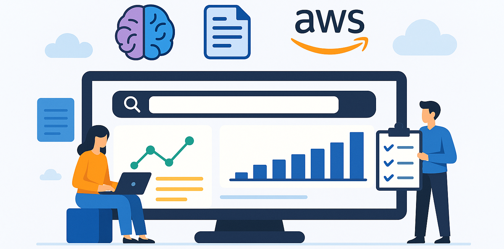
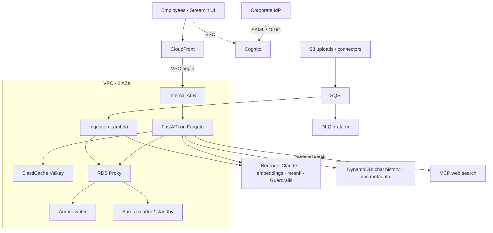

<div align="center">
    
</div>

### Enterprise RAG App on AWS: Bedrock, Aurora pgvector, Fargate, with Web Search via a Remote MCP Server

Terraform-based **Infrastructure as Code (IaC)** for a production Retrieval-Augmented Generation (RAG) application, sized for an organisation of ~2,000 daily employees with 200–500 concurrent users. Employees sign in with their corporate account, upload documents, and ask questions answered by Claude on Amazon Bedrock from the documents they are allowed to see.

👉 Target architecture and sizing: [docs/architecture/production-upgrade.md](docs/architecture/production-upgrade.md)

👉 Related Remote MCP Server: [Web Search using SerpAPI](mcp_servers/) (Streamable HTTP transport), used only when the document library can't answer a question well.

👉 Related UI: [RAG UI (Streamlit)](rag_ui/), single sign-on, streaming chat, uploads with group sharing, history and feedback.

💰 Idle cost of prod is roughly $24/day (Aurora writer + reader, NAT per AZ, Fargate, ElastiCache, RDS Proxy, endpoints). Dev and staging scale Aurora and Fargate to zero outside working hours. See the cost table in the architecture doc.

---

### 🔍 Overview

📌 Key features:
- **Query API on ECS Fargate**: FastAPI service with streamed answers (Server-Sent Events), scheduled + target-tracking autoscaling and ECS-native blue/green deployments with automatic rollback.
- **Edge**: CloudFront → internal ALB through a CloudFront VPC origin; the ALB has no public address.
- **Models on Amazon Bedrock**: Claude (`anthropic.claude-opus-5-5`) for answers through the Messages-API Bedrock endpoint, Titan Text Embeddings V2, Cohere Rerank 3.5, Bedrock Guardrails on questions and answers. IAM auth over VPC endpoints, no API keys.
- **Hybrid retrieval with access control**: Aurora PostgreSQL + pgvector (HNSW) and full-text search fused with reciprocal rank fusion, filtered by a `document_acl` table using the user and groups from the JWT.
- **Aurora with reader as standby**: in prod the reader serves vector search and is the automatic failover target; RDS Proxy pools connections.
- **Semantic cache and rate limits**: ElastiCache (Valkey), scoped by the caller's permissions.
- **Ingestion pipeline**: S3 / connectors → SQS → Lambda with batched embeddings, partial-batch retries and a dead-letter queue with an alarm.
- **Single sign-on**: Cognito federated with the corporate IdP (SAML or OIDC); IdP groups land in the access token.
- **Evaluation**: golden-set evaluation gate in CI, plus asynchronous sampled online evaluation and user feedback.
- **Observability**: CloudWatch dashboard (p95 latency, time-to-first-token, tokens, cost/query, cache hit rate, web-fallback rate), SLO alarms, X-Ray traces via the ADOT collector.
- **CI/CD**: GitHub OIDC (no long-lived AWS keys), blocking test + SonarQube quality gate, immutable images in ECR, eval gate after deploy.

---

### 🏗️ High Level Architecture



More diagrams (network, Aurora failover, scaling, query and ingestion sequences) are in [docs/architecture/production-upgrade.md](docs/architecture/production-upgrade.md).

#### 🗂️ Document ingestion
1. The UI asks `POST /documents/upload-url` for a presigned S3 POST (the user can share the document with groups they belong to) and uploads the file directly to S3.
2. S3 publishes the object-created event to the ingestion SQS queue. Connectors (SharePoint, Confluence sync jobs) publish `{"bucket", "key", "acl": [...]}` messages to the same queue.
3. The `document_processor` Lambda loads and chunks the document, embeds chunks in batches with Bedrock, and replaces the document's chunks and ACL in Aurora in one transaction.
4. Messages that fail three times move to the DLQ, which raises an alarm.

#### 💬 Query
1. `POST /query` with the user's Cognito access token → CloudFront → ALB → FastAPI.
2. Rate-limit check, input guardrail, query embedding, semantic-cache lookup (scoped to the user's ACL principals).
3. On a miss: hybrid search filtered by ACL on the Aurora reader, rerank, optional MCP web search when retrieval is weak.
4. Claude streams the answer; the output guardrail checks it as it streams. The answer is cached, saved to chat history and sampled for online evaluation after the response.

---

### 🗂️ Repository Structure

```
.
├── .github/workflows/
│   ├── deploy.yml             # Tests, quality gate, image build, Terraform, db migrations, eval gate
│   └── manual_cleanup.yml     # Resource cleanup workflow
├── bootstrap/                 # One-time: GitHub OIDC deploy roles + shared ECR repository
├── docs/architecture/         # Production architecture, sizing and cost
├── environments/              # dev / staging / prod roots (same main.tf, different terraform.tfvars)
├── evals/                     # Golden set, fixture documents and the CI evaluation runner
├── modules/
│   ├── auth/                  # Cognito federated with the corporate IdP, app + eval clients
│   ├── bedrock/               # Bedrock Guardrail
│   ├── cache/                 # ElastiCache (Valkey)
│   ├── compute/               # SQS + DLQ, ingestion / db_init / token-enricher Lambdas
│   ├── database/              # Aurora PostgreSQL + pgvector, RDS Proxy, app credentials
│   ├── monitoring/            # SNS, SLO alarms, dashboard
│   ├── query_service/         # ECS Fargate, internal ALB, CloudFront, autoscaling, blue/green
│   ├── storage/               # S3 documents bucket, DynamoDB metadata + chat history
│   └── vpc/                   # VPC, subnets, NAT per AZ, security groups, VPC endpoints
├── mcp_servers/               # Web search MCP server
├── rag_ui/                    # Streamlit UI
├── services/query_api/        # FastAPI query service (Dockerfile, app/, tests/)
├── src/                       # Lambda functions
│   ├── db_init/               # Schema migrations (pgvector, HNSW, document_acl, app role)
│   ├── document_processor/    # SQS-driven ingestion with batched Bedrock embeddings
│   ├── token_enricher/        # Cognito pre-token-generation: IdP groups -> cognito:groups
│   └── tests/                 # Lambda unit tests and post-deploy integration tests
├── sonar-project.properties
└── tox.ini                    # `tox` runs the Lambda and query-service test suites
```

---

### ⚙️ Build and Deployment

#### 🛠️ Prerequisites
- AWS account with access to the Bedrock models in your region: Claude Opus 5.5, Claude Opus 4.8 (refusal fallback), Claude Haiku 5.5 (evaluation judge), Titan Text Embeddings V2 and Cohere Rerank 3.5.
- Terraform 1.5+ and the AWS CLI for the one-time bootstrap.
- A corporate IdP application (Azure AD / Okta) for SAML or OIDC sign-in, for prod. Dev and staging can use Cognito users.
- Optional: SonarCloud for the quality gate, SerpAPI key for the web search MCP server.

#### 1. Bootstrap (once per AWS account, by an administrator)
```bash
cd bootstrap
terraform init && terraform apply -var="github_repo=<owner>/<repo>"
```
This creates the GitHub OIDC provider, one deploy role per environment, and the ECR repository. In GitHub → Settings → Environments, create `dev`, `staging` and `prod` and set the `AWS_DEPLOY_ROLE_ARN` variable of each to the matching `deploy_role_arns` output. Add protection rules (required reviewers) to `prod`.

#### 2. Configure environments
Edit `environments/<env>/terraform.tfvars`:
- `project_name`, `alert_email`
- IdP: `identity_provider_type` (`SAML`, `OIDC` or `NONE`), `saml_metadata_url` or `oidc_issuer` / `oidc_client_id`, and the claim names for email and groups. Put the OIDC client secret in the `OIDC_CLIENT_SECRET` GitHub secret. Register the Cognito SAML ACS / redirect URL `https://<cognito_domain>.auth.<region>.amazoncognito.com/saml2/idpresponse` (or `/oauth2/idpresponse`) at the IdP.
- `ui_callback_urls`: where the Streamlit UI runs.
- `mcp_server_url`: optional web search MCP server.

GitHub secrets: `SONAR_TOKEN` (and `OIDC_CLIENT_SECRET` when using OIDC). No AWS keys.

#### 3. Deploy
Push to `develop` (dev), `staging` (staging) or `main` (prod), or run the workflow manually. The pipeline:
1. Runs the Lambda and query-service tests, `terraform fmt`/`validate`, and the SonarQube quality gate (blocking).
2. Builds the Lambda packages and the query-service image (pushed to ECR, tagged with the commit SHA).
3. Plans and applies Terraform with that image tag, which starts an ECS blue/green deployment.
4. Runs `db_init` (idempotent schema migration) and waits for the ECS rollout; a 5xx alarm during the bake time rolls back automatically.
5. Runs integration tests and the golden-set evaluation gate (`evals/run_eval.py`); the run fails if retrieval hit rate or answer correctness falls below the thresholds.

Pull requests run steps 1–3 as a plan only.

#### First deploy after the upgrade
The upgrade replaces the RDS instance with Aurora and Gemini embeddings with Bedrock embeddings, so no vectors carry over. After the first apply, re-ingest existing documents:
```bash
python scripts/reingest.py \
  --bucket "$(terraform -chdir=environments/prod output -raw document_bucket)" \
  --queue-url "$(terraform -chdir=environments/prod output -raw ingestion_queue_url)"
```
Re-ingested documents are private to their uploader, since uploads made before the upgrade carry no sharing metadata.

---

### 🚀 Running the Web Search MCP Server (optional)

```bash
cd mcp_servers
pip install -r requirements.txt
echo "SERPAPI_API_KEY=your_serpapi_api_key" > .env
python web_search_mcp_server.py --host 0.0.0.0 --port 8000
```
Expose it over HTTPS and set `mcp_server_url` in the environment's `terraform.tfvars`. The query service reaches it through the NAT gateways and only calls it when retrieval from the document library is weak and the user hasn't turned web search off.

### 🔄 Start the Streamlit UI

```bash
cd rag_ui
pip install -r requirements.txt
cp .env.example .env   # fill in from the ui-env-vars artifact of the pipeline run
streamlit run app.py
```
Visit `http://localhost:8501` and sign in with SSO. See [rag_ui/README.md](rag_ui/README.md).

### 🧪 Running tests locally

```bash
pip install tox
tox                       # Lambda unit tests + query service tests
```

---

### 🧰 Utilities

- **`scripts/network-diagnostics.sh`**: troubleshoot connectivity between Lambda and the database within the VPC.
- **`scripts/cleanup.sh`**: tears down resources by name. It predates this architecture and doesn't yet remove ECS, Aurora, RDS Proxy, ElastiCache, CloudFront or SQS resources.

---

### 🤝 Contributing

1. Fork the repository and create a feature branch.
2. Run `tox` and `terraform fmt -recursive` before committing.
3. Open a Pull Request to `develop`.

---

> **Note**: Deploying this infrastructure incurs AWS charges. Review `terraform plan` before applying.
>
> **Security**: Never commit secrets. CI authenticates to AWS with GitHub OIDC; the application reads database credentials from Secrets Manager and calls Bedrock with its IAM role.
