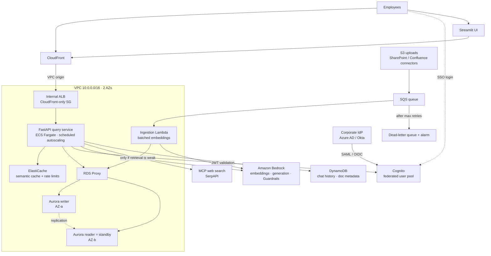
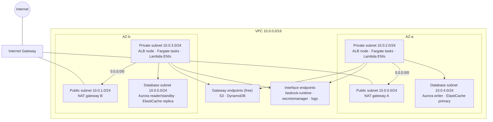
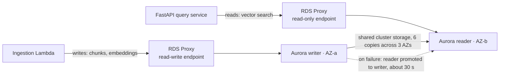
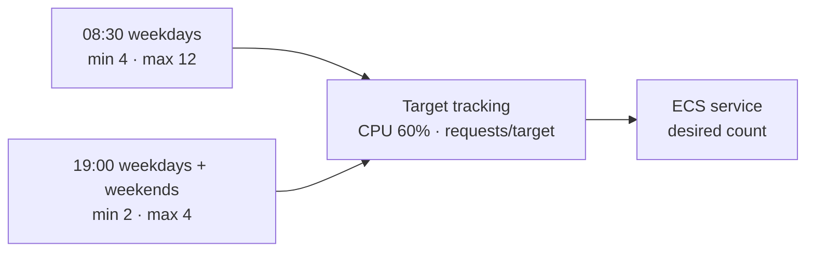
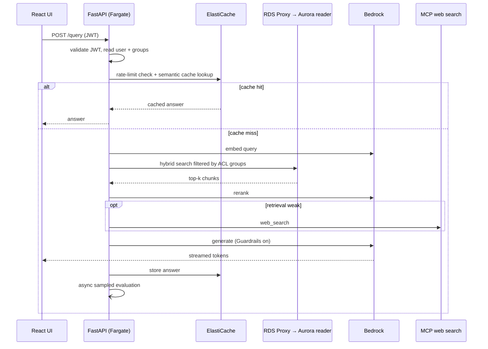
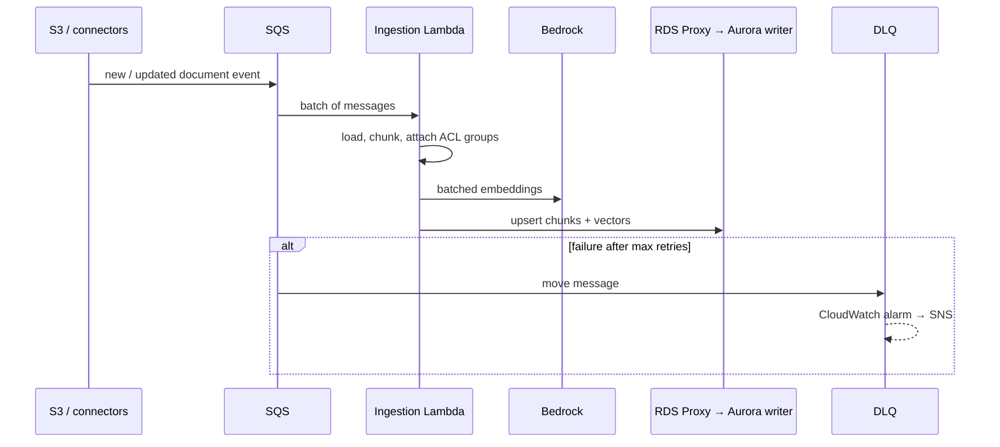

# Production Upgrade Architecture

Target architecture for running the RAG app for an organisation of **~2,000 daily employees with 200–500 concurrent users**.

> Status: **implemented** (Terraform, query service, Lambdas, CI). Not yet applied to an AWS account. See [Implementation notes](#-implementation-notes) for where the build differs from the original design.

---

### 🎯 Sizing Targets

| Metric | Target |
|---|---|
| Daily active users | ~2,000 |
| Concurrent users (peak) | 200–500 |
| Peak query rate | ~500 queries/min (~8–10 req/s), sized for 2× headroom |
| In-flight requests | ~60 (120 with headroom) |
| Daily queries | ~30,000 |
| Corpus (assumption) | ~20,000 documents ≈ 1M chunks |
| Latency SLO | p95 time-to-first-token < 2 s, p95 full answer < 8 s |
| Error rate | < 1% |

---

### 🔁 What Changes

| Layer | Current | Production target |
|---|---|---|
| Edge | API Gateway (REST) | CloudFront → **internal** ALB via CloudFront VPC origin (ALB has no public address). **No WAF**: per-user rate limiting in the app via Redis |
| UI | Streamlit (local) | Streamlit (kept): SSO, streaming chat, chat history, feedback |
| Auth | Cognito sign-up / email verification | Cognito federated with corporate IdP (SAML/OIDC); groups from JWT claims |
| Query API | `query_processor` Lambda | **FastAPI on ECS Fargate**, streaming responses, **scheduled + target-tracking autoscaling** |
| Ingestion | S3 event → Lambda, one chunk at a time | S3 / connectors → **SQS → Lambda** (batched embeddings) + **DLQ** |
| Models | Gemini (free tier, API key) | **Amazon Bedrock** via VPC interface endpoint (IAM auth, Guardrails) |
| Vector DB | RDS PostgreSQL `db.t3.micro`, single-AZ, IVFFlat | **Aurora PostgreSQL + pgvector**: writer + **reader as standby**, HNSW index, **RDS Proxy** |
| Cache | None | ElastiCache (Redis/Valkey): semantic answer cache + rate-limit counters |
| Access control | `user_id` from request body | `user_id` + groups from JWT; `document_acl` table; row-level filtering |
| Network | 2 AZs, 1 NAT gateway | **2 AZs**, 1 NAT per AZ, gateway + interface endpoints |
| Evaluation | LLM judge on every request (inline) | Golden-set eval in CI + async sampled online eval (5–10%) + user feedback |
| Observability | CloudWatch logs + error alarms | Dashboards (p95, TTFT, tokens, cost/query, cache hit, fallback rate), X-Ray/OTel, LLM tracing |
| CI/CD | Long-lived AWS keys, Sonar non-blocking | GitHub OIDC, enforced quality + eval gates, ECS blue/green |

---

### 🏗️ Target High-Level Architecture

---

### 🌐 Network Architecture (2 AZs)

- Each AZ has its own NAT gateway, so losing one AZ does not cut outbound access (MCP web search, ECR image pulls) for the other.
- Bedrock and Secrets Manager traffic stays on the AWS network through interface endpoints; S3/DynamoDB use free gateway endpoints.
- Database subnets have no route to the internet. Aurora accepts 5432 only from the RDS Proxy security group; the proxy accepts traffic only from the Fargate and Lambda security groups.

---

### 🗄️ Aurora: Reader as Standby

- One reader instance serves **both** roles: it takes the vector-search read load and is the automatic failover target. No separate Multi-AZ standby is needed.
- During a failover the promoted instance carries reads and writes until a replacement reader is added.
- Non-prod environments run Aurora Serverless v2 with min capacity 0 (auto-pause) and no reader.

---

### ⏰ Fargate Scheduled Scaling

Application Auto Scaling scheduled actions set the min/max task bounds; target tracking scales within them.

| Window (office timezone, e.g. `Asia/Kolkata`) | Min tasks | Max tasks |
|---|---|---|
| Weekdays 08:30–19:00 | 4 | 12 |
| Weekdays 19:00–08:30 | 2 | 4 |
| Weekends | 2 | 4 |

Target tracking inside those bounds: **CPU 60%** and **ALB requests per target**. Task size: 1 vCPU / 2 GB.

---

### 💬 Query Flow

---

### 📥 Ingestion Flow

---

### 🌍 Environment Differences

| Setting | dev | staging | prod |
|---|---|---|---|
| AZs | 2 | 2 | 2 |
| NAT gateways | 1 | 2 | 2 |
| Aurora | Serverless v2, min 0, no reader | Serverless v2, min 0, no reader | `r6g.large` writer + reader (standby) |
| Fargate | min 0 outside working hours | min 0 outside working hours | schedule above |
| ElastiCache | single small node | single small node | primary + replica |

---

### 💰 Idle Cost (prod, approximate us-east-1 on-demand)

Hourly-billed resources that cost money with zero traffic. Verify with the AWS Pricing Calculator.

| Resource | Approx. per day |
|---|---|
| Aurora `r6g.large` × 2 (writer + reader) | ~$12.50 |
| Fargate (scheduled, 2–4 tasks) | ~$3.30 |
| NAT gateways × 2 | ~$2.20 |
| ElastiCache × 2 | ~$1.50 |
| RDS Proxy | ~$1.45 |
| Interface endpoints (3 × 2 AZs) | ~$1.45 |
| ALB | ~$0.75 |
| Public IPv4, Secrets, KMS, CloudWatch, storage | ~$1.00 |
| **Total** | **~$24/day (~$72 for 3 idle days)** |

Bedrock, Lambda, SQS and CloudFront cost nothing when idle.

---

### 🧾 Implementation Notes

Where the code differs from, or fills in, the design above.

| Area | Decision |
|---|---|
| UI | Streamlit is kept. It signs users in through the Cognito hosted UI (authorization code + PKCE), streams answers over SSE and uploads files straight to S3 with presigned POSTs. |
| Edge | The ALB is internal and CloudFront reaches it through a **VPC origin**, so there is no public ALB endpoint to protect with a shared-secret header. |
| Models | Answers and judge: OpenAI GPT-6 Luna (`us.openai.gpt-6-luna`) through Bedrock's OpenAI-compatible Responses API on `bedrock-runtime`, called with the OpenAI SDK's Bedrock provider (IAM SigV4). Reasoning effort `low` for time-to-first-token. GPT-6 Sol is a drop-in alternative at ~20× the token price. Embeddings: Titan Text Embeddings V2 (1024 dims). Rerank: Cohere Rerank 3.5. All configurable per environment. |
| Guardrails | Applied with the `ApplyGuardrail` API to the question and to the streamed answer (every ~1,500 characters and at the end). A blocked answer is replaced in the UI. |
| Database access | Apps connect as a least-privileged `rag_app` role (password in Secrets Manager). The master password is RDS-managed and used only by `db_init`. Dev/staging have no RDS Proxy, so they keep Serverless v2 auto-pause; prod uses RDS Proxy with a read-only endpoint for the reader. |
| Retrieval | Hybrid search: HNSW cosine + `tsvector` full text, fused with reciprocal rank fusion, ACL-filtered, then reranked. `hnsw.ef_search` and `hnsw.iterative_scan` are role defaults so RDS Proxy connections aren't pinned. |
| Semantic cache | Valkey; entries are scoped to the caller's exact set of ACL principals; exact-match plus cosine ≥ 0.95 over the 200 most recent questions in that scope; 1 h TTL. No invalidation on ingestion beyond the TTL. |
| Groups in tokens | Cognito pre-token-generation (V2, Essentials tier) merges the IdP `custom:groups` attribute into `cognito:groups` in the access token. |
| Ingestion connectors | SharePoint/Confluence sync jobs are not built; they publish `{bucket, key, acl}` messages to the ingestion queue, which the processor already accepts. |
| Online eval | Runs in the query service after the response is sent (sample rate 5% prod, 10% staging), not as a separate worker. |
| CI eval gate | `evals/run_eval.py` runs after every deploy as a Cognito client-credentials client in the `eval` group, against fixture documents shared only with that group. |
| Blue/green | ECS-native blue/green (AWS provider ≥ 6.4) with a 5-minute bake time and rollback on a target-5xx alarm. |
| Not done | WAF (by design), React UI (kept Streamlit), `scripts/cleanup.sh` still targets the old resources, IAM permission boundary for the CI deploy roles. |
