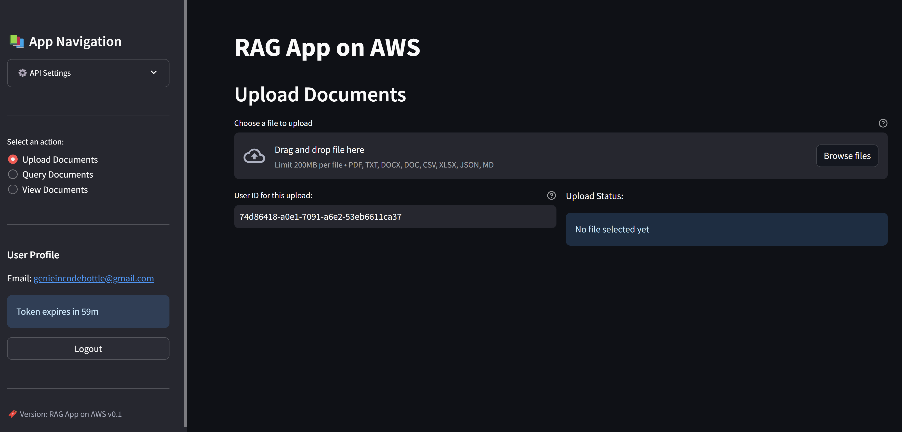

## RAG App: Streamlit UI with AWS Cloud Backend

A Streamlit web app for asking questions about company documents, backed by the FastAPI query service on AWS (Claude on Amazon Bedrock, Aurora pgvector).



### ✨ Features

- Single sign-on through the Cognito hosted UI (federated with the corporate IdP), authorization code + PKCE, automatic token refresh
- Streaming answers in a chat view, with cited sources and relevance scores
- Thumbs up / down feedback on each answer
- Document upload straight to S3, optionally shared with groups you belong to; upload and ingestion status
- History of your questions, with sampled evaluation scores where available
- Per-question toggle for the web search fallback (MCP server) used when the documents don't answer well

### ⚙️ Prerequisites

- Python 3.11+
- The backend deployed by this repository's pipeline
- The URL where the UI runs (default `http://localhost:8501/`) listed in `ui_callback_urls` in `environments/<env>/terraform.tfvars`

### 🚀 Installation

```bash
cd rag_ui
pip install -r requirements.txt
```

### 🛠️ Configuration

Copy `.env.example` to `.env` and fill it in from the `ui-env-vars-<env>` artifact of the pipeline run (or `terraform output`):

```env
API_ENDPOINT=https://dxxxxxxxxxxxx.cloudfront.net
AWS_REGION=us-east-1
COGNITO_CLIENT_ID=your_cognito_app_client_id
COGNITO_DOMAIN=your_cognito_domain_prefix
REDIRECT_URI=http://localhost:8501/
```

### 💡 Usage

```bash
streamlit run app.py
```

Visit `http://localhost:8501` and click **Sign in with SSO**.

### 🔌 API Endpoints Used

- `POST /query`: ask a question; the answer streams back as Server-Sent Events
- `POST /feedback`: rate an answer
- `GET /history`: your previous questions and answers
- `POST /documents/upload-url`, `GET /documents`: upload documents and see their ingestion status

All calls send the Cognito access token; the API reads your user ID and groups from it, so you only get answers from documents you're allowed to see.

### 🔗 Related

- [Backend & infrastructure](../README.md)
- [MCP web search server](../mcp_servers/)
